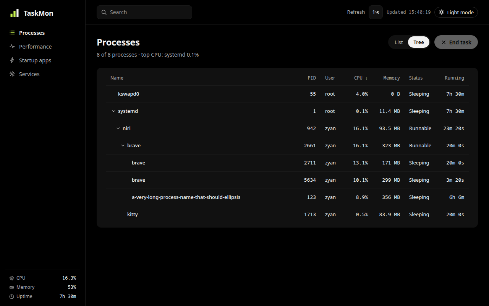
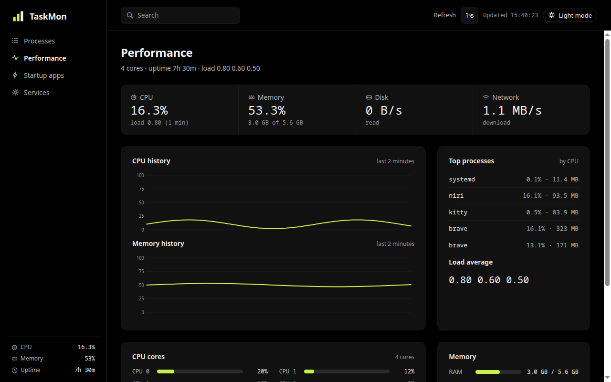
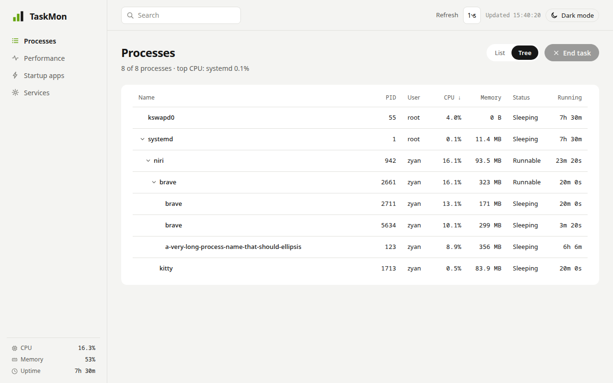

# TaskMon

[](https://github.com/zulian026/taskmon/releases/latest)
[](LICENSE)
[](https://github.com/zulian026/taskmon/releases/latest)
[](https://v2.tauri.app/)
[](https://www.rust-lang.org/)

TaskMon is a Windows Task Manager-style task manager for Linux, built with [Tauri v2](https://v2.tauri.app/) and Rust. It shows what is eating the machine right now: live processes with a collapsible tree, CPU and memory history, startup apps, and systemd services — in one window, with no background daemon.



## Features

### Processes

- **Live list** — every process from `/proc` via `sysinfo`: PID, user, CPU%, memory, status, run time. Sortable columns, search across name / user / PID, 1–5 s refresh.
- **Tree mode** — a List/Tree toggle switches to a parent/child hierarchy. Groups collapse per process, children inherit the active sort, and search shows matches together with their ancestors so nothing is hidden.
- **Detail panel** — command line, executable, working directory, parent process by name, start time, disk read/written.
- **End task / Force kill** — SIGTERM for a clean shutdown, SIGKILL when a process will not die. With children present, **End tree** and **Force kill tree** signal the whole tree, children first and the root last.

### Performance

- **CPU and memory history** — last 2 minutes, per-core bars, load average, RAM/swap meters.
- **Disks and network** — disk usage per mount, live network throughput per interface (loopback excluded), top processes by CPU.



### Startup apps

- **Autostart entries** — from `~/.config/autostart` and `/etc/xdg/autostart`, with a toggle per app. Disabling a system entry writes a user override with `Hidden=true`, the standard freedesktop mechanism — the system file is never touched.

### Services

- **systemd services** — `systemctl list-units --output=json`, user and system scope, with start / stop / restart. System actions may ask for authentication through polkit. Actions are icon-only: stop is red, start and restart use the accent colour.

## Installation

Linux (x86_64) only. Get the latest release from the
[Releases page](https://github.com/zulian026/taskmon/releases/latest) — each release ships the AppImage, the standalone binary, a `.deb` package, and a `.rpm` package.

**AppImage (recommended):**

```bash
chmod +x TaskMon_0.1.1_amd64.AppImage
./TaskMon_0.1.1_amd64.AppImage
```

**Debian package (Debian/Ubuntu):**

```bash
sudo apt install ./TaskMon_0.1.1_amd64.deb
```

Installs `taskmon` to `/usr/bin` with an app-menu entry; dependencies are pulled in automatically.

**RPM package (Fedora/openSUSE):**

```bash
sudo dnf install ./TaskMon-0.1.1-1.x86_64.rpm
```

**Standalone binary:**

```bash
./taskmon
```

On Arch / CachyOS there is no `dpkg` or `apt`, so install from the `.deb` payload manually:

```bash
mkdir -p ~/taskmon-deb && cd ~/taskmon-deb
ar x TaskMon_0.1.1_amd64.deb
sudo tar -xzf data.tar.gz -C /
sudo update-desktop-database /usr/share/applications
sudo gtk-update-icon-cache /usr/share/icons/hicolor
```

## Usage

- **Processes** — click a row for the detail panel. Switch List/Tree in the header; the choice is remembered. In tree mode, click the chevron to collapse a group. Search filters live in both modes.
- **End task** — the header button ends the selected process; the detail panel also offers Force kill, End tree, and Force kill tree when the process has children. Every destructive action asks for confirmation first.
- **Performance** — history covers the last 2 minutes; the refresh interval (1–5 s) is in the top bar.
- **Services** — switch User/System scope in the header. Hover an action button to see what it does.
- **Theme** — the top bar toggles dark (default) and light; the choice is remembered.



## Building from source

Prerequisites: [Node.js](https://nodejs.org/) 18+, a recent stable Rust toolchain ([rustup](https://rustup.rs/)), and the Tauri system dependencies for Linux.

```bash
# Ubuntu / Debian
sudo apt install libwebkit2gtk-4.1-dev build-essential curl wget file \
  libxdo-dev libssl-dev libayatana-appindicator3-dev librsvg2-dev \
  libgtk-3-dev libsoup-3.0-dev patchelf

# Arch / CachyOS
sudo pacman -S webkit2gtk-4.1 gtk3 libayatana-appindicator librsvg \
  base-devel patchelf libsoup3
```

```bash
git clone https://github.com/zulian026/taskmon.git
cd taskmon
npm install
npm run tauri dev    # dev: Vite on :1420 + Tauri window
npm run tauri build  # release: src-tauri/target/release/taskmon
                     # bundles (AppImage, .deb, .rpm) under
                     # src-tauri/target/release/bundle/
```

Tests:

```bash
cd src-tauri
cargo test           # 10 tests: descendant computation, diskstats parsing
```

## Design

True-black-flat: ground `#000`, surface `#111`, lime `#c6f24e` only on data. No gradients, no shadows. Fonts are the system UI fonts (Adwaita Sans / Adwaita Mono, falling back to Noto Sans), no bundled webfonts. Two themes: dark (default) and light, toggled from the top bar and remembered in localStorage. In light mode the data accent is a darker lime green (`#65a30d`) so it stays readable on white. Icons are a single inline SVG set (16px, 1.5px stroke, currentColor): nav items, search, theme toggle (sun/moon), End task, Refresh, service actions (play/stop/restart), KPI labels, the sidebar footer, and the tree chevrons. Layout is containment-first: every grid child has `min-width: 0`, tables use fixed layout with truncated name/description columns, and KPI values shrink instead of spilling into the next cell.

## Project structure

```
.
├── index.html               # Vite entry
├── package.json             # frontend deps (Vite, @tauri-apps/cli, @tauri-apps/api)
├── src/                     # frontend: main.ts, styles.css
├── src-tauri/
│   ├── Cargo.toml
│   ├── tauri.conf.json      # app metadata, version, bundle targets
│   ├── icons/               # app icons
│   └── src/                 # Rust backend
│       ├── monitor.rs       # sampler thread, snapshot, kill, kill tree, diskstats
│       ├── startup.rs       # autostart .desktop parsing and toggling
│       ├── services.rs      # systemctl listing and actions
│       └── lib.rs           # Tauri commands and app setup
├── docs/
│   └── images/              # screenshots
└── release/                 # release binary (not committed)
```

## License

MIT
